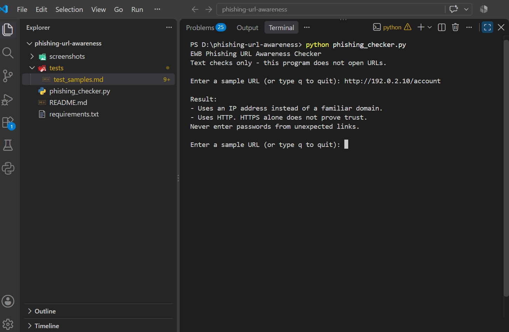
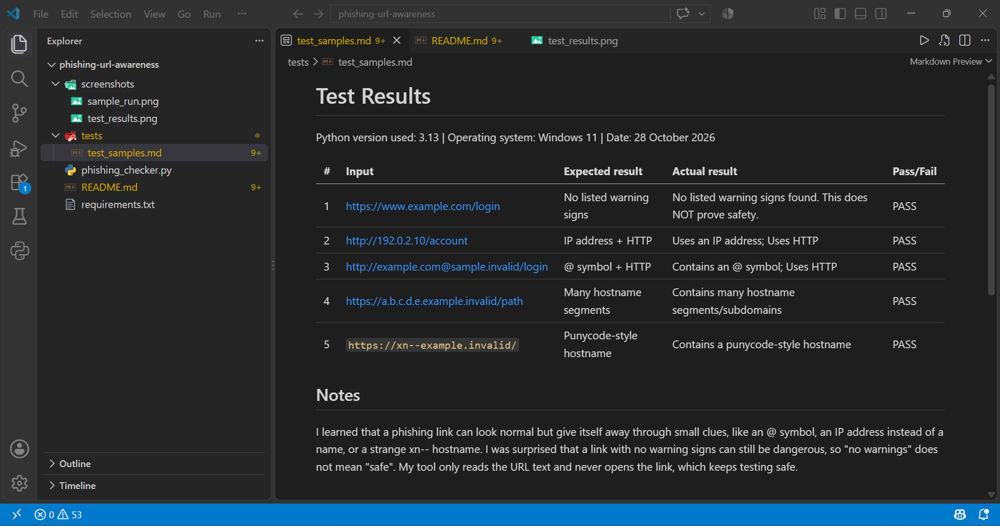

# EWB Phishing URL Awareness Checker

## Overview
Phishing is a trick where a fake link or message tries to make people share passwords, card numbers or OTPs. This project is a small Python command-line tool that reads the text of a URL and points out a few visible warning signs. It never opens the URL.

## Features
- Detects an @ symbol in the URL
- Flags unusually long URLs (over 100 characters)
- Flags IP-address hostnames
- Flags many hostname segments (5 or more)
- Flags punycode-style hostnames (xn--)
- Flags the HTTP scheme
- Loop mode: check several URLs in one run, type q to quit
- Safe handling of malformed input (no crash on text like http://[bad)

## Requirements
Python 3.10 or later. No extra packages.

## How to Run
Windows: python phishing_checker.py

Mac/Linux: python3 phishing_checker.py

## Example Output
Enter a sample URL (or type q to quit): http://192.0.2.10/account

Result:
- Uses an IP address instead of a familiar domain.
- Uses HTTP. HTTPS alone does not prove trust.
Never enter passwords from unexpected links.

## Testing
| # | Input | Expected | Actual | Result |
|---|-------|----------|--------|--------|
| 1 | https://www.example.com/login | No warning signs | No listed warning signs found | PASS |
| 2 | http://192.0.2.10/account | IP address + HTTP | IP address warning; HTTP warning | PASS |
| 3 | http://example.com@sample.invalid/login | @ symbol + HTTP | @ symbol warning; HTTP warning | PASS |
| 4 | https://a.b.c.d.e.example.invalid/path | Many hostname segments | Many hostname segments warning | PASS |
| 5 | https://xn--example.invalid/ | Punycode-style hostname | Punycode-style hostname warning | PASS |

The full table is in tests/test_samples.md.

## Screenshots

## Improvements
1. Loop with quit - the program now keeps asking for URLs until I type q, so I can test many links without restarting. I tested it by entering several URLs in one run and then typing q.
2. Malformed input handling - I added try/except around the URL parsing so text like http://[bad shows a clear message instead of crashing. I tested it by typing that text and re-running all five tests.

## Limitations
This is an educational tool. It only reads URL text. It does not visit
URLs, scan for malware or prove that a URL is safe. No warning signs
found does NOT mean a URL is safe.

## Ethical Use
Use sample strings only. Do not collect credentials. Do not use this
project to deceive anyone or to test websites without permission.

## Author
Yawar Hassan, Cybersecurity Internship, EWB Courses